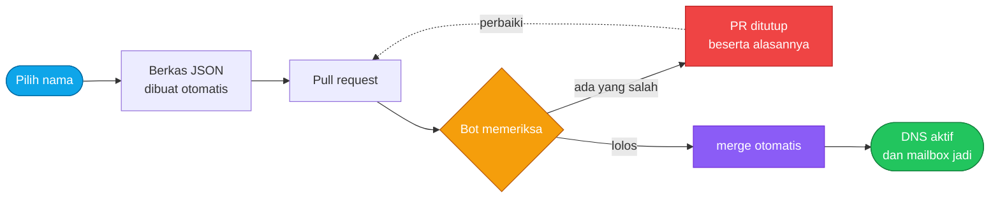
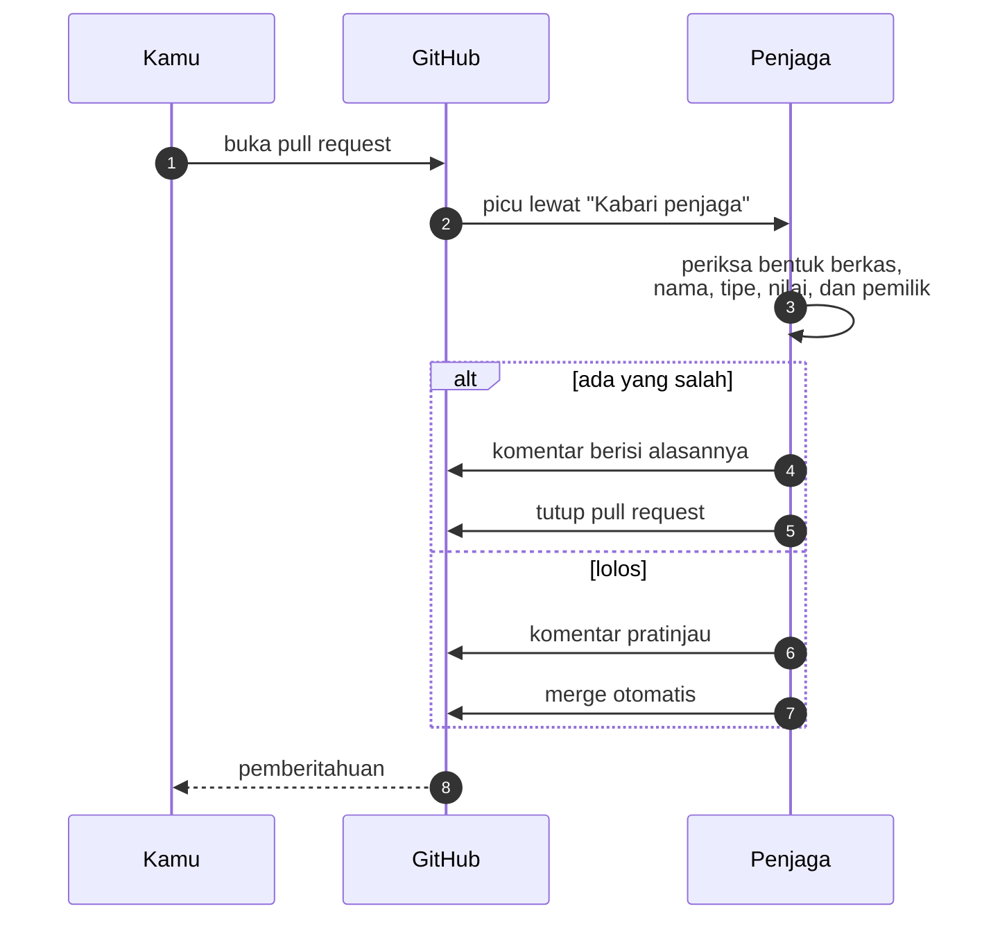

<div align="center">


<a href="https://sang.ceo">
  
</a>

<br/>

[](https://sang.ceo)
[](https://sang.ceo/daftar)
[](https://sang.ceo/email)

<br/>


</div>

---

## Ambil satu, sekarang



Tidak perlu menulis berkas manual. Buka generator, isi kolomnya, tekan tombol. GitHub
terbuka dengan isi yang sudah terisi.

<div align="center">

| | Langkah | Hasil |
|:---:|:---|:---|
| 1 | Buka [sang.ceo/daftar](https://sang.ceo/daftar) | Isi nama dan tujuan |
| 2 | Tekan **Klaim lewat GitHub** | Fork, berkas, dan PR sekaligus |
| 3 | Tunggu beberapa detik | Komentar pratinjau dan merge otomatis |
| 4 | Arahkan domain di hosting | Sertifikat SSL terbit sendiri |

</div>

<div align="center">


</div>

## Berkas klaim

<table>
<tr><th>Subdomain</th><th>Mailbox</th></tr>
<tr><td valign="top">

`data/domains/namamu.sang.ceo.json`

```json
{
  "domain": "sang.ceo",
  "subdomain": "namamu",
  "owner": "username-github",
  "records": {
    "CNAME": "cname.vercel-dns.com"
  }
}
```

</td><td valign="top">

`data/emails/alamat.json`

```json
{
  "domain": "sang.ceo",
  "address": "alamat",
  "type": "mailbox",
  "owner": "username-github"
}
```

</td></tr>
</table>

`owner` terisi sendiri dari akun yang membuka pull request. Kalau ditulis tangan dan
berbeda dengan pembukanya, PR ditolak. Aturan inilah yang mencegah orang mengambil alih
klaim bukan miliknya.

## Tipe record

| Tipe | Isi | Contoh |
|:---|:---|:---|
| `A` | Alamat IPv4 | `76.76.21.21` |
| `AAAA` | Alamat IPv6 | `2606:4700::6810:84e5` |
| `CNAME` | Nama host, tanpa `http://` | `cname.vercel-dns.com` |
| `TXT` | Teks bebas, maksimal 2000 karakter | `verifikasi=abc123` |
| `SRV` | `prioritas bobot port target` | `10 5 443 contoh.com` |
| `CAA` | `flag tag nilai` | `0 issue letsencrypt.org` |

<div align="center">

**Tidak tersedia di sini:** `MX` dan `NS`. `MX` bisa membelokkan surat orang, `NS` bisa
mengambil alih seluruh zona beserta semua subdomain di dalamnya. `PTR`, `SOA`, dan
`DNSKEY` tidak berlaku untuk subdomain klaim.

</div>

CNAME harus satu-satunya record pada namanya. Itu aturan DNS (RFC 1034 dan 1035), bukan
pilihan kami: resolver yang menerima CNAME bersama record lain akan menjawab dengan hasil
yang tidak bisa ditebak.

## Batas yang berlaku

<div align="center">

| Aturan | Batas | Alasan |
|:---|:---:|:---|
| Subdomain per akun | **3** | supaya tetap ada jatah untuk orang lain |
| Record tambahan per subdomain | **10** | cukup untuk verifikasi penyedia |
| Mailbox gratis | **3** | jatah dari penyedia email |
| Panjang TXT | **2000** | batas teknis DNS |
| Berkas di luar `data/` | **ditolak** | repo ini data klaim, bukan kode |

</div>

<div align="center">


</div>

## Struktur

```text
.
├── data/
│   ├── domains/                    # satu subdomain per berkas
│   │   └── nama.sang.ceo.json
│   └── emails/                     # satu mailbox per berkas
│       └── nama.json
├── scripts/
│   ├── validate.mjs                # aturan validasi, dipakai penjaga
│   └── jaga-pr.sh                  # memeriksa, mengomentari, menutup, dan merge
└── .github/workflows/
    ├── pr-beri-tahu.yml            # pemicu secepat mungkin setelah PR dibuka
    └── pr-jaga.yml                 # pekerjaan yang butuh izin tulis
```

## Cara bot bekerja



Pemicunya dipisah dua berkas dengan sengaja. Workflow yang dipicu pull request dari fork
hanya menerima token baca-saja, sekalipun `permissions:` menulis `write`. Jadi berkas
pertama hanya memberi tahu, dan pekerjaan yang butuh izin tulis dilakukan berkas kedua
yang berjalan di repo ini. Hasilnya PR baru ditangani dalam hitungan detik, tanpa tombol
persetujuan yang harus ditekan pemilik repo.

Sesudah merge, pengelola menjalankan sinkronisasi yang membuat record DNS dan akun
mailbox, lalu mengirim sandinya ke email akun GitHub pembuka pull request.

<div align="center">


</div>

## Untuk kontributor

Ingin mengubah aturan, validator, atau alur bot? Baca [CONTRIBUTING.md](./CONTRIBUTING.md)
lebih dulu. PR yang mengubah berkas di luar `data/` ditutup otomatis. Bukan karena tidak
diinginkan, tetapi supaya aturan validasi tidak bisa dilonggarkan lewat pull request yang
terlihat seperti perbaikan biasa.

Validator dijalankan dari versi `main`, bukan versi yang dibawa PR, justru untuk itu.

<div align="center">

---

<sub>Repo ini hanya berisi data klaim. Kode situs, kredensial, dan proses provisioning
tidak ada di sini. Sandi mailbox tidak pernah ditulis ke Git.</sub>


</div>
